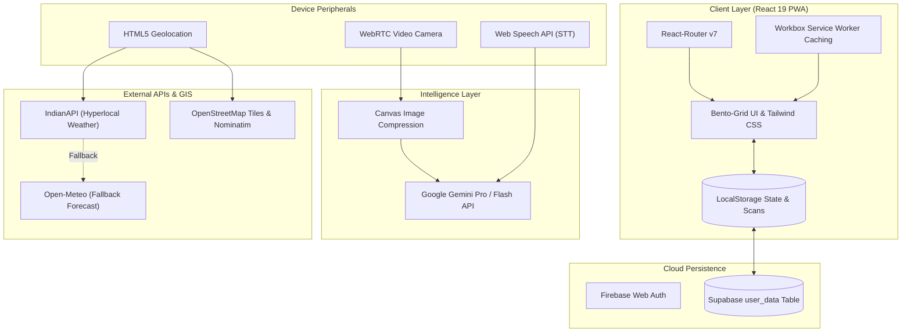
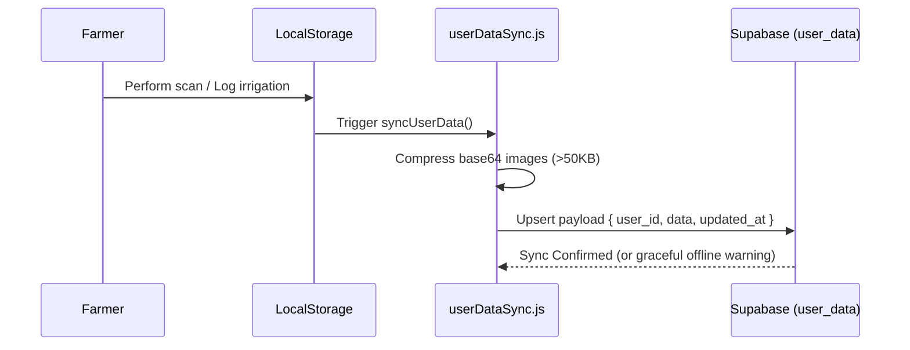

# 🌾 KissanAlert — Comprehensive Technical & Architectural Project Analysis

> **Project URL:** [https://github.com/Pratyush-Panda-2006/KissanAlert](https://github.com/Pratyush-Panda-2006/KissanAlert)  
> **Tagline:** *"Smart Water, Healthy Crops."*  
> **Target Audience:** Indian Agricultural Community (Smallholder & Commercial Farmers)  
> **Platform:** Offline-First Progressive Web Application (PWA)

---

## 📑 Table of Contents
1. [Executive Summary & Mission](#-1-executive-summary--mission)
2. [High-Level System Architecture](#-2-high-level-system-architecture)
3. [Technology Stack & Dependencies](#-3-technology-stack--dependencies)
4. [Deep-Dive Module Breakdown](#-4-deep-dive-module-breakdown)
   - [4.1 AI Diagnostic Scanner (`CameraUpload.jsx`)](#41-ai-diagnostic-scanner-camerauploadjsx)
   - [4.2 Weather & Smart Irrigation Engine (`Weather.jsx`)](#42-weather--smart-irrigation-engine-weatherjsx)
   - [4.3 Geospatial Farm & Water Mapping (`FarmMap.jsx`)](#43-geospatial-farm--water-mapping-farmmapjsx)
   - [4.4 Multilingual Kisan AI Chat Assistant (`ChatAssistant.jsx`)](#44-multilingual-kisan-ai-chat-assistant-chatassistantjsx)
   - [4.5 Farm Analytics & Resource Optimization (`Dashboard.jsx`)](#45-farm-analytics--resource-optimization-dashboardjsx)
   - [4.6 Overview Hub & Scan Management (`Home.jsx`)](#46-overview-hub--scan-management-homejsx)
   - [4.7 Report Generation & Social Export (`ExportShare.jsx`)](#47-report-generation--social-export-exportsharejsx)
5. [Localization & Multilingual Architecture (`i18n.js`)](#-5-localization--multilingual-architecture-i18njs)
6. [Offline-First Strategy & Data Synchronization](#-6-offline-first-strategy--data-synchronization)
7. [Security, Performance & Code Quality Audit](#-7-security-performance--code-quality-audit)
8. [Recommended Roadmap & Action Items](#-8-recommended-roadmap--action-items)

---

## 🎯 1. Executive Summary & Mission

**KissanAlert** is an intelligent, offline-capable Progressive Web Application engineered to tackle two of Indian agriculture's most critical vulnerabilities:
1. **Severe Water Wastage:** Conventional flood irrigation wastes up to **60%** of pumped groundwater. KissanAlert calculates hyperlocal weather forecasts, rain probability, and plant water-stress levels to deliver personalized skip-irrigation or optimized watering schedules.
2. **Crop & Livestock Diagnostic Delays:** Over 70% of Indian farmers lack timely access to agronomists and veterinarians. KissanAlert provides a dual-domain AI vision scanner that instantly detects diseases in plants and domestic animals, specifies severity, calculates health percentages, and recommends immediate actionable treatments in the farmer's native language.

---

## 🏗️ 2. High-Level System Architecture

---

## 💻 3. Technology Stack & Dependencies

| Category | Technology | Version | Purpose |
| :--- | :--- | :--- | :--- |
| **Core Framework** | React | `^19.2.4` | Modern component UI rendering with concurrent features |
| **Bundler / Tooling** | Vite | `^7.0.0` | Ultra-fast HMR and production asset bundler |
| **Styling** | Tailwind CSS | `^3.4.19` | Utility-first CSS with custom brand palette and animations |
| **Routing** | React Router DOM | `^7.13.1` | Client-side routing and layout orchestration |
| **AI Integration** | `@google/generative-ai` | `^0.24.1` | Official Google SDK for Gemini multimodal models |
| **Maps & GIS** | Leaflet & React-Leaflet | `^1.9.4` / `^5.0.0` | Interactive maps, spatial markers, and tile rendering |
| **Data Sync** | `@supabase/supabase-js` | `^2.108.2` | Cloud database upsert and data restoration |
| **Authentication** | Firebase | `^12.15.0` | User identity and authentication management |
| **PWA Engine** | `vite-plugin-pwa` | `^1.2.0` | Offline caching, Workbox runtime strategies, web app manifest |
| **Image Compression** | `browser-image-compression` | `^2.0.2` | Client-side image downscaling prior to AI payload dispatch |
| **Iconography** | `lucide-react` | `^0.577.0` | Lightweight SVG icons |

---

## 🔍 4. Deep-Dive Module Breakdown

### 4.1 AI Diagnostic Scanner (`CameraUpload.jsx`)
* **Hardware Interfacing:** Uses `navigator.mediaDevices.getUserMedia` with `facingMode: 'environment'` to prioritize the rear camera on mobile devices.
* **Payload Optimization:** Converts camera frames to canvas and invokes `compressImage()` downscaling images to a max width of 800px at 70% quality, preventing network payload errors and latency spikes.
* **Agricultural Verification Gate:** The prompt requires Gemini to first classify the image. Non-agricultural uploads immediately return `{ "isValid": false }` to prevent API token waste and hallucinated diagnoses.
* **Dual-Domain Scope:** Distinct diagnostic logic for **Crops** (leaves, stems, roots, fruits) and **Livestock** (cows, buffaloes, goats, poultry, etc.).
* **Model Failover Cascade:** Sequentially attempts:
  1. `gemini-2.5-flash`
  2. `gemini-2.0-flash`
  3. `gemini-1.5-flash`
* **JSON Output Schema:**
  * `identity`: Crop variety or animal breed
  * `diagnosis`: Suspected condition or healthy verification
  * `severity`: Critical, Moderate, or Healthy
  * `healthPercentage`: 0–100% integer
  * `affectedArea`: Specific anatomical or botanical part
  * `possibleConditions`: Array of 3 differential diagnoses
  * `immediateCare`: First-aid instructions for the farmer
  * `urgency`: Immediate, Within 24h, or Routine
  * `actionPlan`: Comprehensive treatment and precaution plan
  * `waterStress`: None, Mild, Moderate, or Severe
  * `irrigationAdvice`: Specific watering recommendations

### 4.2 Weather & Smart Irrigation Engine (`Weather.jsx`)
* **Layered Geolocation & Fallback:**
  1. HTML5 Geolocation coordinates resolved via Nominatim OpenStreetMap reverse geocoding into city/district names.
  2. Primary call to `IndianAPI` (`weather.indianapi.in`) with API key authorization.
  3. Automatic fallback to `Open-Meteo` with WMO code translation if `IndianAPI` is unreachable or rate-limited.
* **30-Minute Cache Lifespan:** Weather payloads are cached in `localStorage` under `kisanalert_cached_weather` to enable instant offline rendering.
* **Smart Irrigation Advisory Algorithm:** Feeds current atmospheric metrics (temperature, humidity, wind, precipitation) and 7-day precipitation probabilities into Gemini along with recent crop scan results to produce an actionable watering decision (e.g., skip watering if precipitation is >70% within 48h).

### 4.3 Geospatial Farm & Water Mapping (`FarmMap.jsx`)
* **Field & Water Source Pins:** Farmers can tap the map to place pins designating either field plots or water bodies (Borewells, Wells, Canals, Rivers, Ponds).
* **Proximity Calculation:** Implements the mathematical **Haversine formula** to calculate exact great-circle distance (in meters) between crops and water sources:
  $$\Delta \sigma = 2 \arcsin \left( \sqrt{\sin^2\left(\frac{\Delta \phi}{2}\right) + \cos(\phi_1)\cos(\phi_2)\sin^2\left(\frac{\Delta \lambda}{2}\right)} \right)$$
  $$d = R \cdot \Delta \sigma$$
* **Spatial State Sync:** Mapped coordinates and water source attributes are immediately synchronized with the Supabase database.

### 4.4 Multilingual Kisan AI Chat Assistant (`ChatAssistant.jsx`)
* **Context-Enriched System Prompt:** Injects live farmer parameters into Gemini's context:
  * Farmer name, primary language, farm type, and primary water source.
  * Recent scan history and health percentages.
  * Milk yields, livestock weights, crop harvest yields, and growth metrics.
* **Voice-First Input:** Integrated with browser `SpeechRecognition` / `webkitSpeechRecognition`, dynamically configuring speech recognition locale tags (`hi-IN`, `bn-IN`, `te-IN`, `ta-IN`, `mr-IN`, `gu-IN`, `kn-IN`, `or-IN`, `pa-IN`, `as-IN`, `ur-IN`, `ne-NP`).

### 4.5 Farm Analytics & Resource Optimization (`Dashboard.jsx`)
* **Custom SVG Visualizations:** `MiniBarChart` component renders dynamic vertical bars with gradient fills without external heavy charting libraries.
* **Multi-Resource Tracking:**
  * Livestock metrics: Daily Milk Yield (L) and Animal Weight Logs (kg).
  * Crop metrics: Harvest Yield (kg) and Plant Growth Logs (cm).
  * Water metrics: Water Usage Volume (L) and Irrigation Cycles (Drip, Sprinkler, Furrow, Flood).
* **Automated AI Resource Planning:** Generates on-demand feeding budgets, fertilizer protocols, and water management plans.

### 4.6 Overview Hub & Scan Management (`Home.jsx`)
* **Operational Overview:** Displays overall crop and livestock health scores, issue counts, and recent insights.
* **Category Filtering:** Quick tabs for Recent, Crops, and Livestock.
* **Detail Inspection Modal:** Full report breakdown with delete capabilities and export actions.

### 4.7 Report Generation & Social Export (`ExportShare.jsx`)
* **WhatsApp Formatted Messages:** Assembles emoji-bulleted diagnostic summaries and opens `wa.me` for instant messaging with local agricultural extension workers or veterinarians.
* **Print / PDF Engine:** Embeds a `@media print` stylesheet to cleanly format and print clinical diagnosis sheets.

---

## 🌐 5. Localization & Multilingual Architecture (`i18n.js`)

KissanAlert natively supports **all 22 Eighth-Schedule official languages of India** plus English:

| # | Language | Native Script | # | Language | Native Script |
|---|---|---|---|---|---|
| 1 | English | English | 13 | Maithili | मैथिली |
| 2 | Hindi | हिन्दी | 14 | Sindhi | سنڌي |
| 3 | Bengali | বাংলা | 15 | Sanskrit | संस्कृतम् |
| 4 | Telugu | తెలుగు | 16 | Urdu | اردو |
| 5 | Marathi | मराठी | 17 | Nepali | नेपाली |
| 6 | Tamil | தமிழ் | 18 | Konkani | कोंकणी |
| 7 | Gujarati | ગુજરાતી | 19 | Manipuri | मणिपुरी |
| 8 | Kannada | ಕನ್ನಡ | 20 | Bodo | বোড়ো |
| 9 | Odia | ଓଡ଼ିଆ | 21 | Dogri | डोगरी |
| 10 | Malayalam | മലയാളം | 22 | Santali | سنتالی |
| 11 | Punjabi | ਪੰਜਾਬੀ | 23 | Kashmiri | ಕಾಶ್ಮೀರಿ |
| 12 | Assamese | অসমীয়া | | | |

* **Zero-Dependency Translation Layer:** Custom dictionary utility with fallback to English.
* **Event-Driven UI Updates:** Changes to language dispatch a custom window event (`kisanalert_translation_updated`), prompting layouts to re-render immediately.
* **Dynamic AI Translation:** Prompts request Gemini to translate all dynamic output values directly into the target language while preserving JSON structure.

---

## ⚡ 6. Offline-First Strategy & Data Synchronization

### Workbox Cache Configurations (`vite.config.js`)
* **Open-Meteo Weather API:** `StaleWhileRevalidate` with 30-minute expiration.
* **OpenStreetMap Map Tiles:** `CacheFirst` with a 7-day expiration and up to 200 cached tile assets.
* **Leaflet Marker Icons & CDN Assets:** `CacheFirst` with 30-day expiration.
* **Nominatim Geocoding:** `StaleWhileRevalidate` with 24-hour expiration.
* **Google Fonts (Stylesheets & Webfonts):** `CacheFirst` / `StaleWhileRevalidate` up to 365 days.

### Cloud Synchronization (`userDataSync.js`)

---

## 🛡️ 7. Security, Performance & Code Quality Audit

### ⚠️ Critical Findings & Security Considerations
1. **Client-Side Exposed Secrets:**
   * `src/pages/Weather.jsx` (Line 7): Contains a hardcoded API key:  
     `const INDIAN_API_KEY = 'sk-live-53uikf89OPzAFpjJWJMtU84OxsMD4uPEWeqC21dP';`
   * `src/utils/firebase.js`: Contains hardcoded Firebase configuration and keys.
   * `src/utils/supabaseClient.js`: Contains hardcoded Supabase project URL and anon key.
   * **Remediation:** Move API requests behind a serverless proxy (Cloudflare Workers, Netlify Functions, or Firebase Cloud Functions).
2. **Passthrough Auth Guard:**
   * `src/components/AuthGuard.jsx` currently executes `return children;` without verifying session tokens.
   * **Remediation:** Connect Firebase `onAuthStateChanged` to redirect unauthenticated traffic to a login/onboarding screen.
3. **Scan History Mock Data:**
   * `src/pages/ScanHistory.jsx` displays static mock entries ("Tomato Plant", "Cow Angus") instead of reading from `localStorage.getItem('smartAgHistory')`.
   * **Remediation:** Unify `ScanHistory.jsx` with the real state from `Home.jsx`.
4. **PWA Manifest Asset Mismatch:**
   * `vite.config.js` declares `pwa-192x192.png` and `pwa-512x512.png`, while `public/` contains `logo.png` and `favicon.png`.
   * **Remediation:** Generate matching icon sizes in `public/` to ensure 100% PWA installability compliance.

---

## 🚀 8. Recommended Roadmap & Action Items

- [ ] **Secret Decoupling:** Rotate the exposed IndianAPI key and proxy weather requests through environment-secured serverless endpoints.
- [ ] **Authentication Gate:** Implement active session verification in `AuthGuard.jsx` with mobile phone OTP authentication (ideal for Indian rural demographics).
- [ ] **Offline Voice Output (TTS):** Integrate browser SpeechSynthesis (TTS) so illiterate or visually impaired farmers can listen to AI diagnoses spoken in their regional language.
- [ ] **Unified Scan Store:** Replace static data in `ScanHistory.jsx` with the dynamic `smartAgHistory` store and add date-range search filters.
- [ ] **PWA Asset Alignment:** Generate standard `192x192` and `512x512` PNG icon assets to ensure smooth mobile browser home-screen installation.

