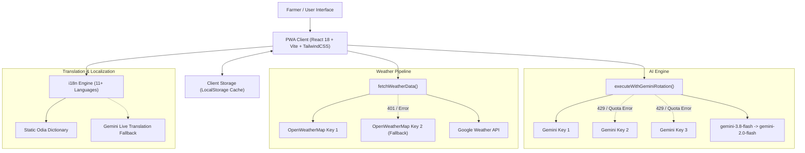

# 🌾 KissanAlert — Smart Water, Crop Diagnostics & Farm Advisory System

> **"Smart Water, Healthy Crops, Empowered Farmers."**  
> An offline-first, high-performance Progressive Web Application (PWA) powered by Google Gemini AI, Google Maps Platform, and OpenWeatherMap. Engineered to eliminate agricultural water waste, diagnose crop and livestock diseases with actionable remedies, and provide hyper-localized advisory in **Odia (ଓଡ଼ିଆ)** and **11+ Indian languages**.

---

## 📑 Table of Contents
1. [Project Overview & Problem Statement](#-project-overview--problem-statement)
2. [Key Highlights & Innovation](#-key-highlights--innovation)
3. [System Architecture & Technology Stack](#-system-architecture--technology-stack)
4. [Core Features Breakdown](#-core-features-breakdown)
   - [AI Multi-Key Failover Engine](#1-ai-multi-key-failover-engine)
   - [Computer Vision Diagnostic Pipeline](#2-computer-vision-diagnostic-pipeline)
   - [Weather Intelligence & Smart Irrigation](#3-weather-intelligence--smart-irrigation)
   - [Full Odia & Multilingual Localization Engine](#4-full-odia--multilingual-localization-engine)
   - [Dynamic Farm Health & Scan History](#5-dynamic-farm-health--scan-history)
   - [GIS Smart Farm Map & Water Proximity](#6-gis-smart-farm-map--water-proximity)
   - [Predictive Resource Analytics & Yield Planners](#7-predictive-resource-analytics--yield-planners)
   - [Export & Community Advisory Sharing](#8-export--community-advisory-sharing)
   - [Offline-First Progressive Web App (PWA)](#9-offline-first-progressive-web-app-pwa)
5. [Complete Repository Structure](#-complete-repository-structure)
6. [Data Schemas & Specifications](#-data-schemas--specifications)
7. [Environment Variables Configuration](#-environment-variables-configuration)
8. [Installation & Local Setup](#-installation--local-setup)
9. [Production Build & Deployment](#-production-build--deployment)
10. [Hackathon Presentation & Viva FAQ](#-hackathon-presentation--viva-faq)

---

## 🌍 Project Overview & Problem Statement

Agriculture in India and developing nations faces three interconnected crises:
1. **Severe Water Inefficiency**: Traditional flood irrigation wastes 50–60% of water through runoff and evaporation, while unpredictable rainfall damages standing crops.
2. **Delayed Disease Diagnostics**: Farmers often detect fungal, bacterial, or pest infestations too late, losing 20–40% of their annual crop yield. Professional veterinarians and agronomists are often inaccessible in remote areas.
3. **Linguistic & Technological Barriers**: Modern agricultural tech is overwhelmingly in English, leaving vernacular-speaking farmers (e.g., Odia, Hindi, Telugu, Tamil) excluded from real-time advisory.

**KissanAlert** bridges this divide by delivering an AI agronomist and water conservation manager directly into the farmer's pocket. It combines on-device computer vision, real-time meteorological forecasting, water budget analytics, and native vernacular localization into a lightweight, offline-resilient PWA.

---

## ✨ Key Highlights & Innovation

- 🔄 **3-Key Gemini AI Rotation & Failover**: Automatic rotation across 3 Google Gemini API keys with model fallback (`gemini-3.8-flash` prioritized) prevents downtime and quota errors.
- 🌦️ **Dual-Provider Weather Intelligence**: Integrated Google Maps Weather Platform + OpenWeatherMap dual-key failover for hyper-local forecasts and rain-triggered water skip advisories.
- 🗣️ **Deep Vernacular Odia (ଓଡ଼ିଆ) Localization**: Seamless translation of every UI element, dashboard metric, navigation link, and AI diagnostic report into authentic Odia script (ଓଡ଼ିଆ ଅକ୍ଷର/ଲିପି) with localized remedies.
- 📷 **Instant Multi-Subject Vision Scanner**: Recognizes crops, fruits, vegetables, and livestock (cows, goats, poultry, etc.). Computes health scores, disease diagnosis, severity, urgency, water stress, and step-by-step first-aid action plans.
- 📈 **Dynamic, Image-Driven Health Tracking**: Health scores dynamically reflect the farmer’s actual uploads rather than static placeholders.
- 🗺️ **GIS Farm & Water Source Mapping**: Leaflet-powered satellite mapping with field polygon boundaries and Haversine proximity calculations to the nearest water reservoir.
- 📲 **Instant Advisory Sharing**: One-click WhatsApp sharing and formatted PDF generation in the farmer's native language.
- ⚡ **Offline-First PWA**: Compliant with PWA standards (192x192 & 512x512 icons, service worker precaching, local storage caching) allowing uninterrupted access in rural areas.

---

## 🏗️ System Architecture & Technology Stack



### **Core Stack**
| Layer | Technologies |
|---|---|
| **Frontend Framework** | React 18 (Hooks, Context, Functional Components) |
| **Build Tool & Bundler** | Vite 7.3.1 |
| **Styling & UI** | Tailwind CSS v3, Glassmorphism, CSS Custom Keyframes |
| **Icons & Media** | Lucide React |
| **AI & Multimodal Vision** | Google Generative AI SDK (`@google/generative-ai`), Gemini 3.8 Flash |
| **Weather & Geospatial** | OpenWeatherMap API, Google Maps Platform, Leaflet, React-Leaflet |
| **PWA & Offline Support** | `vite-plugin-pwa`, Workbox Service Workers, CacheStorage API |
| **Data Persistence** | Browser `localStorage` (offline-first) + Supabase REST Sync |

---

## 🔍 Core Features Breakdown

### 1. AI Multi-Key Failover Engine
Located in `src/utils/geminiKey.js`:
- Pools up to three separate Gemini API keys:
  1. `VITE_GEMINI_API_KEY`
  2. `VITE_GEMINI_API_KEY_2`
  3. `VITE_GEMINI_API_KEY_3`
  4. User-provided custom key from Settings (`localStorage.getItem('user_gemini_api_key')`)
- When a scan or query is triggered, `executeWithGeminiRotation()` iterates through available keys. If an API key hits a rate limit (HTTP 429), quota restriction, or deprecation error, it automatically fails over to the next key without failing the farmer's request.
- Automatically selects supported models: `['gemini-3.8-flash', 'gemini-2.0-flash', 'gemini-2.5-flash', 'gemini-1.5-flash']`.

### 2. Computer Vision Diagnostic Pipeline
Located in `src/pages/CameraUpload.jsx`:
- **Client-Side Image Pre-Compression**: Uses HTML5 Canvas (`src/utils/imageCompressor.js`) to scale down high-resolution smartphone photos (max 800px, 0.7 JPEG quality), avoiding network lag and payload timeouts.
- **Agricultural Validation Gate**: The AI verifies if the image is an actual agricultural subject (crop, plant, vegetable, fruit, livestock animal). Non-agricultural images are rejected instantly to prevent API token waste.
- **Deep Diagnostic Fields**:
  - `identity`: Specific crop variety or livestock breed.
  - `diagnosis`: Detected disease, pest, nutrient deficiency, or "Healthy".
  - `severity`: Critical, Moderate, or Healthy.
  - `healthPercentage`: Dynamically computed score (0–100%).
  - `waterStress`: None, Mild, Moderate, or Severe (checks for leaf curling, wilting, or dehydration).
  - `irrigationAdvice`: Tailored watering advice based on observed symptoms.
  - `urgency`: Immediate, Within 24h, or Routine.
  - `immediateCare`: Emergency first-aid remedies before professional help arrives.
  - `actionPlan`: Detailed chemical, biological, or managerial treatment protocols.

### 3. Weather Intelligence & Smart Irrigation
Located in `src/pages/Weather.jsx`:
- Fetches real-time weather, temperature, humidity, wind speed, pressure, sunrise/sunset, and 7-day precipitation forecasts.
- City search covering all major agricultural districts across India.
- **Smart Irrigation Advisory**: Translates meteorological forecast into actionable water advice:
  - *Rain Imminent (>60% chance)*: Advises farmers to **skip irrigation** to save water and prevent root rot.
  - *High Heat / Low Humidity*: Advises **early-morning or evening drip irrigation** to minimize evaporative loss.
  - *Normal Conditions*: Recommends standard scheduled watering.

### 4. Full Odia & Multilingual Localization Engine
Located in `src/utils/i18n.js`:
- Extensive pre-compiled dictionary for **Odia (ଓଡ଼ିଆ)**, Hindi (हिन्दी), Telugu (తెలుగు), Tamil (தமிழ்), Bengali (বাংলা), Marathi (मराठी), Gujarati (ગુજરાતી), Kannada (ಕನ್ನಡ), Malayalam (മലയാളം), Punjabi (ਪੰਜਾਬੀ), and Urdu (اردو).
- **Zero Hardcoded English Strings**: All UI headers, bottom nav labels, card titles, button states, and weather descriptions call `t(...)`.
- **Dynamic Vernacular AI Reports**: When Odia is selected, Gemini prompts mandate that all diagnostic fields, immediate care instructions, and action plans be returned directly in **fluent Odia script (ଓଡ଼ିଆ ଅକ୍ଷର/ଲିପି)**.
- **Background AI Translation Fallback**: If an uncached string appears, `translateWithGemini()` translates it in the background and saves it to local cache (`kisanalert_translations_[lang]`).

### 5. Dynamic Farm Health & Scan History
Located in `src/pages/Dashboard.jsx` and `src/pages/ScanHistory.jsx`:
- **Real-Time Health Analytics**:
  - Scans are indexed into `localStorage.getItem('smartAgHistory')`.
  - The Dashboard automatically calculates the average health percentage for **Crops** and **Livestock** based on the farmer's uploaded photos.
- **Search & Filterable History**:
  - Real-time search filter by crop variety, animal breed, or disease diagnosis.
  - Time filter: All Time, Today, This Week, This Month.
  - Visual severity badges (Critical: Red, Moderate: Amber, Healthy: Green).

### 6. GIS Smart Farm Map & Water Proximity
Located in `src/pages/FarmMap.jsx`:
- Leaflet map integration displaying the farmer's land plots.
- Allows farmers to pin fields and water sources (Borewell, Well, Canal, River, Pond).
- Calculates the exact distance in meters from each field to the nearest water reservoir using the **Haversine formula**.

### 7. Predictive Resource Analytics & Yield Planners
Located in `src/pages/Analytics.jsx`:
- **Water Consumption Tracking**: Logs daily/weekly irrigation volumes across irrigation methods (Drip, Sprinkler, Flood, Furrow).
- **Yield Logs**: Records harvested weight (kg), plant height (cm), and growth phases.
- **Livestock Logs**: Tracks animal weight, lactation yields (liters/day), and health histories.

### 8. Export & Community Advisory Sharing
Located in `src/components/ExportShare.jsx`:
- **WhatsApp Share**: Formats the diagnostic report into a clean, bolded message with emoji bullet points in the farmer's native language.
- **Print / PDF Generator**: Generates an official, print-ready AI diagnostic sheet with the KissanAlert logo, health score gauge, urgency status, and remedies.

### 9. Offline-First Progressive Web App (PWA)
Configured via `vite.config.js` and `vite-plugin-pwa`:
- Fully installable on Android, iOS, Windows, and macOS ("Add to Home Screen").
- Pre-caches static assets, icons, fonts, and styles.
- Generates standard 192x192 and 512x512 PWA icons in `public/`.
- Functional offline for reviewing historical scans, farm maps, and logged profiles.

---

## 📁 Complete Repository Structure

```
KissanAlert/
├── public/
│   ├── favicon.ico              # Browser favicon
│   ├── logo.png                 # Master high-resolution app logo
│   ├── pwa-192x192.png          # PWA Android standard launcher icon
│   └── pwa-512x512.png          # PWA splash screen & high-res icon
├── src/
│   ├── assets/                  # Vector illustrations and media
│   ├── components/
│   │   ├── BottomNav.jsx        # Persistent mobile navigation bar (Home, Scan, AI, Settings)
│   │   ├── ExportShare.jsx      # WhatsApp and PDF report exporter with i18n
│   │   └── Layout.jsx           # App layout wrapper, header, and theme providers
│   ├── pages/
│   │   ├── Analytics.jsx        # Resource optimizer, irrigation & yield tracking
│   │   ├── CameraUpload.jsx     # Live camera/gallery scanner + Gemini diagnostic flow
│   │   ├── ChatAssistant.jsx    # Kisan AI multilingual agricultural chatbot
│   │   ├── Dashboard.jsx        # Bento-grid dashboard with dynamic health scores
│   │   ├── FarmMap.jsx          # Leaflet GIS field and water source mapping
│   │   ├── Home.jsx             # Welcome splash and quick navigation
│   │   ├── Profile.jsx          # Farmer profile, language switcher, custom API keys
│   │   ├── ScanHistory.jsx      # Filterable & searchable history of scans
│   │   └── Weather.jsx          # Weather forecast & smart irrigation advisory
│   ├── utils/
│   │   ├── geminiKey.js         # Multi-key failover manager & model rotation
│   │   ├── i18n.js              # 11-language dictionary + live Gemini translation fallback
│   │   ├── imageCompressor.js   # Client-side canvas image compression utility
│   │   ├── supabaseClient.js    # Optional cloud database synchronization client
│   │   └── userDataSync.js      # LocalStorage to cloud synchronization handler
│   ├── App.jsx                  # Root router (React Router DOM v6)
│   ├── index.css                # Tailwind CSS imports and glassmorphic styling
│   └── main.jsx                 # React root renderer with PWA registration
├── .env                         # Local environment variables (ignored by Git)
├── .env.example                 # Environment variables template
├── index.html                   # HTML entry point with meta tags and mobile viewport
├── package.json                 # Node dependencies and build scripts
├── PROJECT_ANALYSIS.md          # Architectural analysis and evaluation document
├── README.md                    # Project documentation
├── tailwind.config.js           # Tailwind theme configuration
└── vite.config.js               # Vite config with PWA Workbox generator
```

---

## 📋 Data Schemas & Specifications

### 1. Scan Record Schema (`localStorage: smartAgHistory`)
```json
{
  "id": 1732104500000,
  "date": "20/11/2026",
  "image": "data:image/jpeg;base64,...",
  "isValid": true,
  "type": "Crop",
  "identity": "ବାଇଗଣ (Brinjal)",
  "diagnosis": "ଫଳ ଏବଂ କାଣ୍ଡ ବିନ୍ଧା ପୋକ (Shoot & Fruit Borer)",
  "severity": "Critical",
  "healthPercentage": 45,
  "waterStress": "Moderate",
  "irrigationAdvice": "ମାଟି ଶୁଖିଲା ଥିବାରୁ ସନ୍ଧ୍ୟା ସମୟରେ ହାଲୁକା ପାଣି ଦିଅନ୍ତୁ।",
  "affectedArea": "କଅଁଳ ଡାଳ ଏବଂ ଫଳ",
  "possibleConditions": [
    "ଫଳ ଏବଂ କାଣ୍ଡ ବିନ୍ଧା ପୋକ (Shoot and Fruit Borer)",
    "ପତ୍ର କୁଞ୍ଚନ ରୋଗ (Little Leaf Disease)",
    "ବ୍ୟାକ୍ଟେରିଆଲ୍ ୱିଲ୍ଟ (Bacterial Wilt)"
  ],
  "immediateCare": "ଆକ୍ରାନ୍ତ ଫଳ ଓ ଡାଳ ଗୁଡ଼ିକୁ ତୁରନ୍ତ କାଟି ନଷ୍ଟ କରିଦିଅନ୍ତୁ।",
  "urgency": "Immediate",
  "actionPlan": "୧. ନିମ୍ବ ତେଲ (୫ ମି.ଲି. / ଲିଟର) ସ୍ପ୍ରେ କରନ୍ତୁ।\n୨. ଉପଦ୍ରବ ଅଧିକ ଥିଲେ ସ୍ପାଇନୋସାଡ୍ କୀଟନାଶକ ପ୍ରୟୋଗ କରନ୍ତୁ।"
}
```

### 2. User Profile Schema (`localStorage: SMART_AG_USER_PROFILE`)
```json
{
  "name": "ରମେଶ ମଲ୍ଲିକ",
  "phone": "9876543210",
  "farmType": "Irrigated",
  "waterSource": "Borewell",
  "primaryCrop": "Rice",
  "language": "ଓଡ଼ିଆ (Odia)"
}
```

---

## 🔐 Environment Variables Configuration

Create a `.env` file in the root of the project directory based on `.env.example`:

```env
# ==========================================
# Google Gemini AI Keys (Automatic 3-Key Rotation)
# ==========================================
VITE_GEMINI_API_KEY=your_gemini_key_1_here
VITE_GEMINI_API_KEY_2=your_gemini_key_2_here
VITE_GEMINI_API_KEY_3=your_gemini_key_3_here

# ==========================================
# Weather APIs (Dual Provider & Dual Key Failover)
# ==========================================
# Google Maps Platform Weather API Key
VITE_GOOGLE_WEATHER_API_KEY=your_google_weather_api_key_here

# OpenWeatherMap API Keys (Primary & Fallback)
VITE_WEATHER_API_KEY=your_openweathermap_key_1_here
VITE_WEATHER_API_KEY_2=your_openweathermap_key_2_here

# ==========================================
# Supabase Backend Sync (Optional Cloud Persistence)
# ==========================================
VITE_SUPABASE_URL=https://your-supabase-project.supabase.co
VITE_SUPABASE_ANON_KEY=your_supabase_anon_key_here
```

---

## 💻 Installation & Local Setup

### Prerequisites
- [Node.js](https://nodejs.org/) (version 18.0.0 or higher)
- `npm` (version 9.0.0 or higher) or `yarn` / `pnpm`

### Step 1: Clone the Repository
```bash
git clone https://github.com/AdityaNarayanPadhi/KissanAlert.git
cd KissanAlert/KissanAlert
```

### Step 2: Install Dependencies
```bash
npm install
```

### Step 3: Setup Environment
```bash
cp .env.example .env
# Open .env and insert your API keys
```

### Step 4: Start the Development Server
```bash
npm run dev
```
Open your browser and navigate to:  
👉 **`http://localhost:5173/`**

---

## 📦 Production Build & Deployment

### Build for Production
To generate minified, production-optimized assets with PWA precache manifests:
```bash
npm run build
```
The output files will be created in the `dist/` directory.

### Preview Production Build Locally
```bash
npm run preview
```

### Deployment to Vercel
1. Push your code to GitHub.
2. Go to [Vercel](https://vercel.com/) and click **"Add New Project"**.
3. Import your GitHub repository (`KissanAlert`).
4. Set the Root Directory to `KissanAlert` (if nested).
5. Add your environment variables in the Vercel project settings (`VITE_GEMINI_API_KEY`, `VITE_WEATHER_API_KEY`, etc.).
6. Click **Deploy**.

---

## 🎤 Hackathon Presentation & Viva FAQ

**Q1: How does KissanAlert help solve water scarcity in agriculture?**  
*Answer:* KissanAlert pairs 7-day precipitation forecasts with AI-driven soil and leaf condition analysis. If rainfall is imminent (>60% probability), it tells the farmer to skip irrigation, conserving hundreds of thousands of liters of groundwater across acreage. It also recommends appropriate irrigation methods (drip vs. furrow) based on visible water stress.

**Q2: What happens if an API key runs out of quota during a field demo?**  
*Answer:* KissanAlert has an automated failover engine (`geminiKey.js`). It cycles between 3 pre-configured Gemini keys and multiple OpenWeatherMap keys. If Key 1 fails or hits a rate limit, Key 2 takes over in milliseconds without throwing an error to the user.

**Q3: How is language accessibility handled for non-English speaking farmers?**  
*Answer:* The entire user interface, navigation, and settings are localized in 11+ Indian languages, with primary emphasis on Odia (ଓଡ଼ିଆ). Diagnostic prompts sent to Gemini explicitly mandate answers in authentic Odia script (ଓଡ଼ିଆ ଅକ୍ଷର) with proper agricultural terms, avoiding awkward phonetic translations.

**Q4: Can the app work in areas with poor or no internet connectivity?**  
*Answer:* Yes. KissanAlert is built as an offline-first PWA. All past scans, diagnostic history, user profile settings, and farm maps are saved locally in the browser’s `localStorage` and `CacheStorage`. When connectivity is restored, data can synchronize with cloud backends.

---

## 📄 License
This project is licensed under the **MIT License**.

---

**Developed with ❤️ for Indian Farmers & Global Water Sustainability.**
